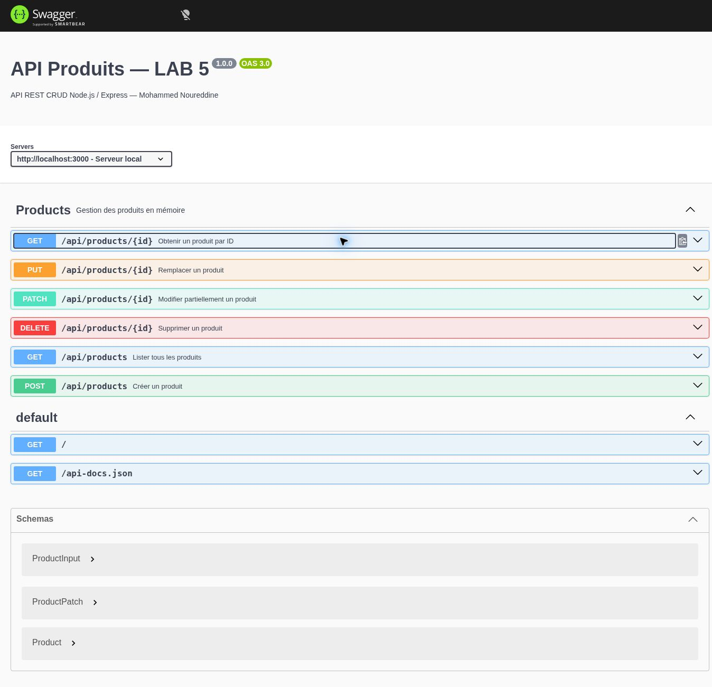
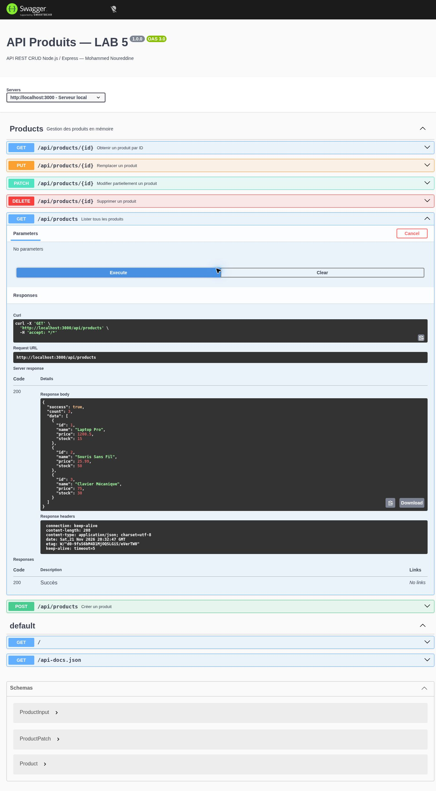
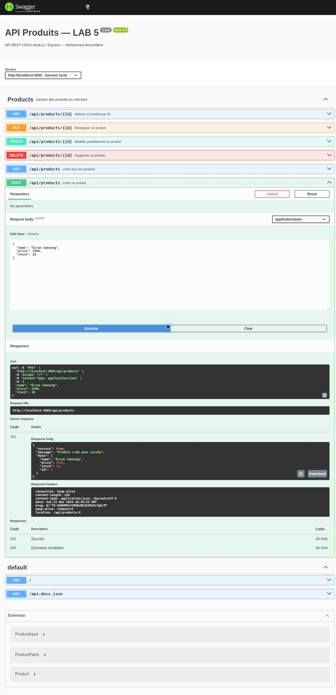
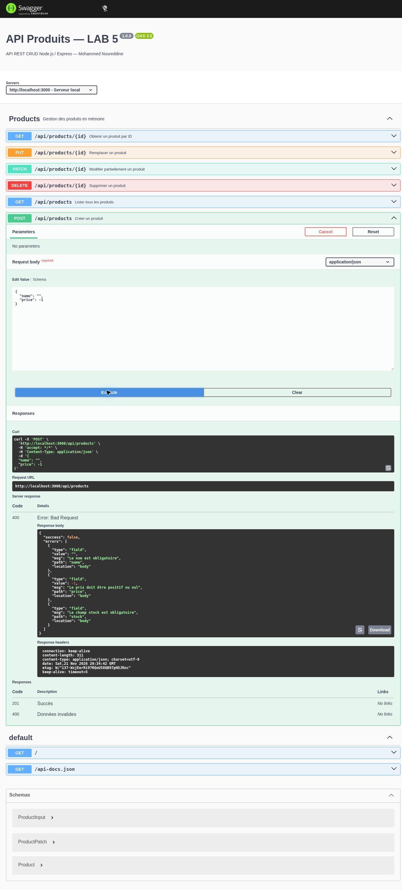
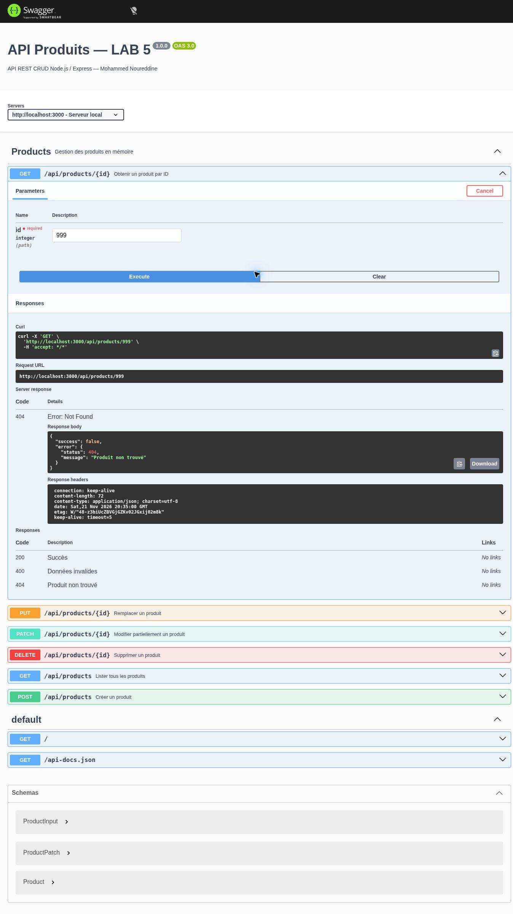
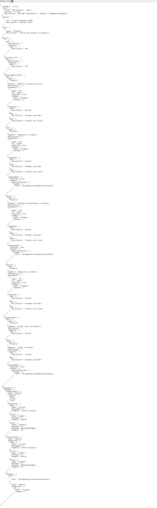
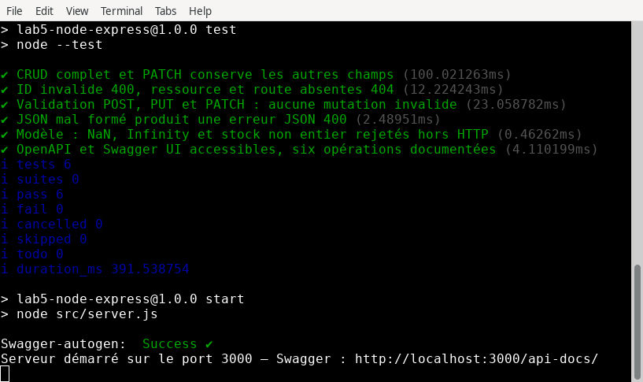

# LAB 5 — API REST CRUD avec Node.js et Express

**Mohammed Noureddine — medfree2** · Développement Backend avec Java, Node.js et PHP

API de gestion des produits avec une architecture en couches, validation HTTP et métier, erreurs JSON centralisées et documentation OpenAPI 3 générée au démarrage.

## Installation et exécution

Node.js **22 ou supérieur** recommandé (le lab demande au minimum 18 ; réalisation vérifiée avec Node 24).

```bash
git clone https://github.com/medfree2/lab5-node-express.git
cd lab5-node-express
npm ci
npm start
```

- API : http://localhost:3000/api/products
- Interface interactive : http://localhost:3000/api-docs/
- OpenAPI JSON : http://localhost:3000/api-docs.json

Copier `.env.example` en `.env` pour changer `PORT`. `npm run dev` active le redémarrage automatique. `npm run swagger` régénère la documentation. **Aucune authentification n'est demandée dans ce lab.**

## Architecture

| Dossier / fichier | Responsabilité |
|---|---|
| `src/routes/` | URLs, verbes HTTP, validation et annotations Swagger |
| `src/controllers/` | Requête et réponse HTTP, transmission des erreurs |
| `src/services/` | Validation métier, existence du produit, fusion PATCH |
| `src/repositories/` | Tableau en mémoire, CRUD asynchrone, génération des IDs |
| `src/models/` | Modèle Product et contraintes métier |
| `src/middlewares/` | Validation express-validator et erreurs centralisées |
| `src/app.js` | Assemblage Express, routes et Swagger UI |
| `src/server.js` | Génération Swagger et démarrage du serveur |
| `swagger.js` | Schémas OpenAPI et génération automatique |

## Endpoints

| Méthode | Route | Succès | Opération |
|---|---|---|---|
| GET | `/api/products` | 200 | Liste avec `count` et `data` |
| GET | `/api/products/:id` | 200 | Détail d'un produit |
| POST | `/api/products` | 201 | Création avec en-tête Location |
| PUT | `/api/products/:id` | 200 | Remplacement complet |
| PATCH | `/api/products/:id` | 200 | Modification des seuls champs fournis |
| DELETE | `/api/products/:id` | 204 | Suppression, réponse sans corps |

`name` : chaîne non vide après suppression des espaces extérieurs. `price` : nombre fini >= 0. `stock` : entier sûr >= 0. POST et PUT exigent les 3 champs ; PATCH valide seulement ceux fournis. L'identifiant est généré côté serveur et ne peut pas être imposé par le corps JSON. Les champs supplémentaires sont ignorés.

Les identifiants invalides et données invalides donnent **400**, les produits ou routes absents **404**. Le middleware masque les détails internes pour les erreurs **500**. Un JSON mal formé donne également une réponse JSON 400.

## Exemples cURL

Sous PowerShell, utiliser `curl.exe` à la place de `curl`.

```bash
curl -i http://localhost:3000/api/products
curl -i -X POST http://localhost:3000/api/products -H 'Content-Type: application/json' -d '{"name":"Tapis","price":10,"stock":5}'
curl -i -X PUT http://localhost:3000/api/products/1 -H 'Content-Type: application/json' -d '{"name":"Clavier Gamer","price":80,"stock":10}'
curl -i -X PATCH http://localhost:3000/api/products/1 -H 'Content-Type: application/json' -d '{"stock":20}'
curl -i -X DELETE http://localhost:3000/api/products/3
curl -i http://localhost:3000/api/products/1abc
curl -i http://localhost:3000/api/products/999
```

Dans Swagger UI, ouvrir une opération, cliquer **Try it out**, remplir les paramètres puis **Execute**.

## Vérification

```bash
npm run swagger
npm test
```

**6 tests d'intégration et de modèle réussis**, incluant : CRUD complet, protection de l'ID, conservation des champs avec PATCH, non-réutilisation d'un ID supprimé, erreurs 400/404, absence de mutation après validation invalide, JSON mal formé, valeurs NaN/Infinity rejetées par le modèle, six opérations OpenAPI et Swagger UI accessible. Les tests démarrent une vraie instance HTTP Express sur un port disponible.

## Captures réelles de l’exécution

Ces 7 captures proviennent du navigateur Swagger UI et du terminal exécutant le code de ce dépôt. Elles montrent les requêtes exécutées et leurs vraies réponses ; aucune image générée ou reconstituée.

### 1. Interface Swagger et opérations disponibles



### 2. GET : liste des 3 produits — 200 OK



### 3. POST : création d’un écran — 201 Created



### 4. POST invalide : nom vide, prix négatif et stock absent — 400



### 5. GET : produit 999 inexistant — 404



### 6. Spécification OpenAPI JSON servie par Express



### 7. Terminal : 6 tests réussis et serveur démarré



## Collection Postman

Importer [Lab5.postman_collection.json](postman/Lab5.postman_collection.json). La variable `baseUrl` vaut `http://localhost:3000`. Les 10 requêtes couvrent CRUD, PATCH et erreurs. Exécuter la collection sur un serveur fraîchement démarré car DELETE modifie les données en mémoire.

## Corrections apportées aux exemples du support

- Appel de `new Product(name, price, stock)` aligné sur son constructeur à 3 arguments.
- Compteur d'IDs monotone, pour éviter de réutiliser le dernier identifiant supprimé.
- Copies des données à la sortie du repository, afin d'éviter une modification externe du tableau.
- `app.js` séparé du démarrage pour faciliter les tests HTTP.
- Génération Swagger attendue avant le démarrage ; création du dossier de sortie ; normalisation du chemin sans slash final, des schémas de produits et des paramètres d'ID générés.

## Limites

Le stockage est **en mémoire** : chaque redémarrage réinitialise les 3 produits de démonstration. Le prix utilise le type Number demandé dans ce lab ; pour de vrais calculs financiers, choisir une représentation décimale adaptée. Ce projet pédagogique n'intègre ni base de données ni JWT (ce sont des extensions proposées par le support).
